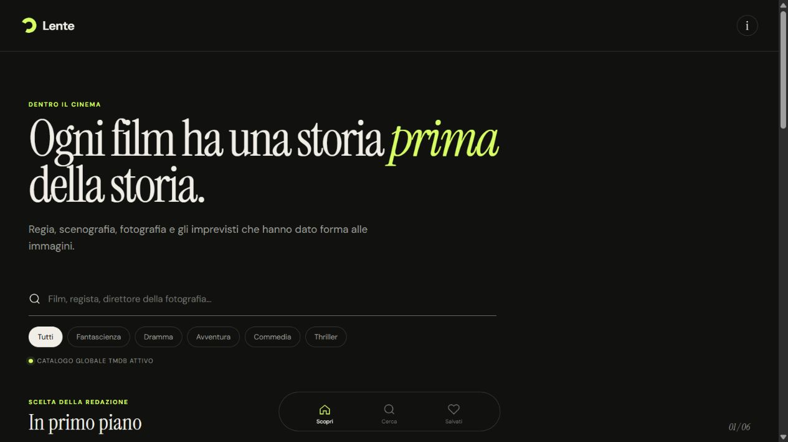

# Lente — Dentro il cinema

> **Work in progress** — progetto personale ancora in sviluppo. Le funzionalità e l’interfaccia possono cambiare.

Lente è una PWA dedicata al cinema, pensata per esplorare film e contenuti attraverso un’interfaccia utilizzabile anche da smartphone.

**[Apri la demo pubblica](https://lente-cinema-teoboba.matteonesich92.chatgpt.site)**

## Funzionalità disponibili

- Catalogo di film con ricerca.
- Filtri per genere.
- Schede di dettaglio dei film.
- Interfaccia adattata all’uso da telefono.

## Stato del progetto

L’app è utilizzabile, ma lo sviluppo non è concluso. Il codice sorgente sarà aggiunto a questo repository dopo il recupero e la verifica dei file del progetto. Al momento questo README documenta la demo pubblica e lo stato del lavoro; **il repository non contiene ancora i sorgenti dell’app**.

## Prossimi passi

- Pubblicare i sorgenti verificati e le istruzioni per l’avvio locale.
- Completare e rifinire le funzionalità della PWA.
- Documentare le scelte tecniche.
